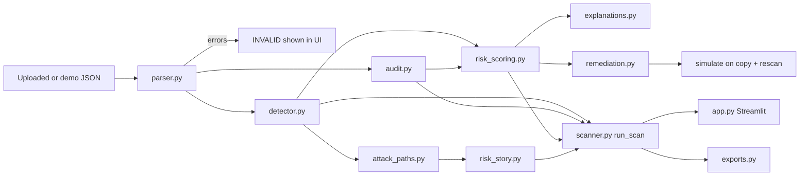

# CloudGuard AI

**AI-Powered Cloud Misconfiguration & Identity Risk Detection**

*GO FAST. KNOW WHEN TO STOP.*

CloudGuard AI analyzes cloud configuration snapshots, identity permissions, access relationships, and audit events to uncover security risks, explain their impact, prioritize remediation, and preview safer configurations before a human approves any changes.

> All data in this repository is **synthetic**. The input is a simplified demonstration schema, **not** native AWS configuration output. The app never connects to a cloud account and needs no credentials or API key.

## 1. Features implemented

- Safe JSON input with size limits, schema checks, duplicate-ID checks, and dangling-reference reporting.
- Public-exposure detection for sensitive resources, with UNKNOWN handling when `public_access` is absent.
- IAM-style checks: excess privilege against declared `required_actions`, wildcard scope, conditional scope, and explicit Deny handling (exact-match only).
- Audit indicators: public-access changes, permission changes, denied requests (never counted as success), undeclared actors on sensitive reads, and missing context.
- Transparent 0-100 scoring with a per-factor breakdown, an evidence cap, and confidence levels.
- NetworkX graph of entry points, identities, and resources, showing only validated edges. Includes verified and incomplete path search.
- Risk Story that connects verified steps and lists missing links.
- Deterministic explanations for every finding. An optional LLM path is off by default and falls back to templates.
- Policy-as-code remediation proposals for human review, or a checklist when no exact safe patch can be established.
- Local simulation: patch a copy, re-run the real scanner, and compare before and after.
- Streamlit dashboard, with filters, findings explorer, detail view, graph, audit timeline, Risk Story, remediation center, and exports (JSON, CSV, Markdown).

## 2. Architecture



See `docs/ARCHITECTURE.md` for module responsibilities.

## 3. Technology stack

- Python 3.11+ (tested on 3.12)
- Streamlit (UI), pandas (tables and CSV), NetworkX (graph), Plotly (charts and graph)
- pytest (tests)
- Optional: an OpenAI-compatible SDK for LLM explanations. It is **not** in `requirements.txt` and is only used if installed and enabled.

## 4. Requirements

- Python 3.11 or newer.
- Dependencies pinned as ranges in `requirements.txt`.

## 5-7. Setup, install, and launch

### Windows PowerShell

```powershell
cd cloudguard-ai
python -m venv .venv
.\.venv\Scripts\Activate.ps1
python -m pip install -r requirements.txt
streamlit run app.py
```

If activation is blocked, run this once and try again: `Set-ExecutionPolicy -Scope CurrentUser RemoteSigned`

### macOS / Linux

```bash
cd cloudguard-ai
python3 -m venv .venv
source .venv/bin/activate
python -m pip install -r requirements.txt
streamlit run app.py
```

Streamlit opens the dashboard at `http://localhost:8501`.

## 8. Test command

```bash
python -m pytest -q
python scripts/smoke_test.py
```

The smoke test runs the scanner on the demo data and then drives the real Streamlit app headlessly (load demo, run scan, open remediation preview).

## 9. Demo instructions

1. Run `streamlit run app.py`.
2. Click **Load Demo Dataset**, then **Run Scan**.
3. Walk through Overview, Findings, Identity Graph, Audit Timeline, Risk Story, Remediation, and Exports.
4. Follow `docs/DEMO_SCRIPT.md` for the timed 2 to 3 minute version.

## 10. Input schema

Top-level keys: `schema_version` (must be `"1.0"`), `dataset_name`, `synthetic`, `resources`, `identities`, `relationships`, `entry_points`.

```json
{
  "schema_version": "1.0",
  "resources": [
    {"id": "bucket-customer-data", "type": "storage", "sensitive": true, "public_access": true}
  ],
  "identities": [
    {"id": "app-service-role", "type": "service",
     "permissions": [{"effect": "Allow", "actions": ["GetObject", "PutObject"],
                      "resources": ["bucket-customer-data"], "conditions": {}}],
     "required_actions": ["GetObject"]}
  ],
  "relationships": [
    {"source": "app-service-role", "target": "bucket-customer-data",
     "type": "has_access", "evidence": "Synthetic verified policy relationship", "validated": true}
  ],
  "entry_points": [
    {"id": "public-web-app", "type": "application", "publicly_exposed": true,
     "uses_identity": "app-service-role"}
  ]
}
```

Rules: IDs are unique across resources, identities, and entry points. Relationship endpoints must exist; otherwise the relationship is excluded with a warning. A missing field means UNKNOWN, never false or safe. Audit logs use `{"schema_version": "1.0", "events": [...]}`, with `id`, `timestamp`, `actor`, `action`, `resource`, `outcome` (`success`, `denied`, `failed`, `unknown`), `source_ip`, and `details`.

## 11. Finding and risk-score explanations

Each finding has a stable ID such as `PUBLIC_SENSITIVE_RESOURCE:-:bucket-customer-data`. The score is:

`score = round(0.35 × exposure + 0.30 × sensitivity + 0.20 × privilege_breadth + 0.15 × evidence_quality)`

Each factor is 0-100. Weights are configurable through the `weights` argument of `run_scan` and must sum to 1.0. Bands: 0-19 Informational, 20-39 Low, 40-59 Medium, 60-79 High, 80-100 Critical. Audit indicators are capped at 79. A score is capped at 59 when evidence quality is below 30.

**The score is a prioritisation heuristic. It is not a probability of compromise.**

The advisory decision is GO, WATCH, or STOP. STOP requires a finding with score 60 or higher and high confidence.

## 12. Graph and Risk Story semantics

- **Verified** means every edge on the path is explicitly supplied and `validated: true`. The entry-point link from `uses_identity` is declared explicitly.
- **Incomplete** means a path exists only through unvalidated edges. Missing links are listed.
- **No verified path** means nothing has been invented.
- A verified path is a **configuration path**, not proof of exploitability.

## 13. Remediation simulation behavior

Proposals are generated only when the input gives enough context. Public-access proposals set `public_access` to false. IAM proposals narrow Allow actions to declared `required_actions`, keep conditions, and never touch Deny statements. Wildcard resource scope is never narrowed automatically.

The simulation deep-copies the input, applies the patch to the copy, re-runs `run_scan`, and compares finding IDs and scores. The original input is verified unchanged. Results are labelled **LOCAL SIMULATION — NOT A REAL CLOUD CHANGE**. Proposals are labelled **PROPOSED — HUMAN APPROVAL REQUIRED**.

## 14. Optional LLM setup and privacy

The LLM path is **off by default**. It requires all of the following:

1. `CLOUDGUARD_LLM_ENABLED=true`
2. `OPENAI_API_KEY` set in the environment
3. An installed OpenAI-compatible SDK (`pip install openai`, not in requirements)
4. An explicit checkbox opt-in in the sidebar

What is sent: one finding's ID, rule title, evidence lines, and limitations, with secret-like values redacted. The model's output must parse as JSON and match the requested finding ID, or it is rejected. Any error or timeout falls back to templates. The model can never change scores, severity, findings, graph, or policy. Copy `.env.example` to `.env` only if you use LLM mode.

## 15. Security limitations

- The input is synthetic and simplified. It is not a faithful AWS model.
- IAM evaluation is conservative pattern matching, not full policy evaluation.
- Conditions are recorded but not evaluated.
- Explicit Deny applies to exact action strings only.
- Uploads are size-limited and parsed as data. Nothing is executed, and uploaded content is never rendered as HTML.
- Secrets are not required. Avoid uploading real credentials.

## 16. Known limitations and future work

- No native AWS parsing or live connector.
- Condition evaluation and full IAM semantics are not implemented.
- Correlated findings (for example a public bucket and a path to it) are both reported. They are grouped in the Risk Story and never summed.
- The UI upload flow is not covered by an automated test. The validation logic is tested through the scanner, and the upload path was checked by code review only.
- The LLM client has not been validated against a live API. Its fallback behaviour is tested with injected fake clients.
- Multi-user storage and authentication are out of scope.

## 17. Suggested team roles

See `docs/TEAM_PLAN.md`. Four roles: parser and detection; audit and graph; risk, explanations and remediation; dashboard and integration.

## 18. Troubleshooting

- **`streamlit: command not found`**: activate the virtual environment first, or run `python -m streamlit run app.py`.
- **Execution policy error on Windows**: run `Set-ExecutionPolicy -Scope CurrentUser RemoteSigned` once.
- **Blank graph**: the input has no validated relationships. Check the Risk Story for the missing links.
- **"Invalid JSON at line X"**: fix the syntax at that line, then click Validate Input again.
- **Port already in use**: run `streamlit run app.py --server.port 8502`.
- **Tests fail on import**: run `python -m pytest -q` from the project root so `pytest.ini` sets the Python path.
