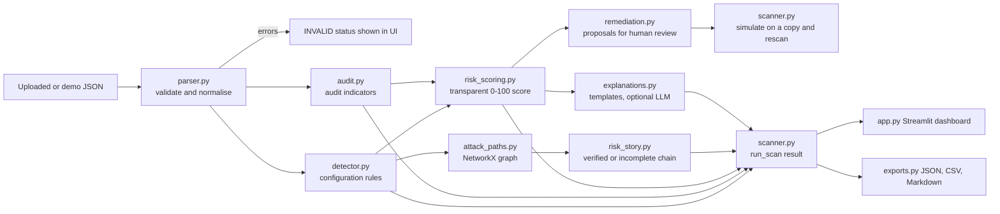

# CloudGuard AI Architecture

CloudGuard AI is a deterministic, advisory pipeline. The Streamlit UI renders the output of one scanner function and contains no detection logic.

## Module responsibilities

| Module | Responsibility |
|---|---|
| `models.py` | Constants, score bands, weights, finding factory, stable IDs |
| `parser.py` | Size limits, safe JSON parsing, schema and reference validation, UNKNOWN for missing fields |
| `detector.py` | Public exposure, IAM excess and wildcard scope, relationship and path findings, deduplication |
| `audit.py` | Audit indicators: public-access changes, permission changes, denied requests, missing context |
| `risk_scoring.py` | Deterministic weighted score, evidence cap, confidence, severity bands |
| `attack_paths.py` | Graph of entry points, identities and resources; bounded path search; verified versus incomplete |
| `risk_story.py` | Connected narrative with missing links shown explicitly |
| `explanations.py` | Template explanations; optional LLM path with validation and fallback |
| `remediation.py` | Exact patch when context allows; checklist otherwise; apply to a copy only |
| `scanner.py` | Single pipeline, decision (GO / WATCH / STOP), simulation and comparison |
| `exports.py` | JSON, CSV and Markdown output |
| `app.py` | Streamlit UI that consumes scanner output |

## Key design decisions

- **Stable finding IDs** are derived from rule and affected assets, for example `PUBLIC_SENSITIVE_RESOURCE:-:bucket-customer-data`. Before/after comparison relies on this.
- **Same functions before and after remediation.** The simulation re-runs `run_scan` on a patched copy. Expected results are never hardcoded.
- **Edges come only from explicit input.** The graph never infers a relationship from co-location.
- **Scores are prioritisation aids** and are capped when evidence is weak.
- **Audit events are indicators**, kept separate from configuration findings and capped below Critical.

## Known simplifications

- The input schema is a demonstration schema, not native AWS configuration.
- IAM evaluation is conservative pattern matching, not full policy evaluation.
- Conditions are recorded as evidence but are not evaluated.
- Explicit Deny matches exact action strings only.
